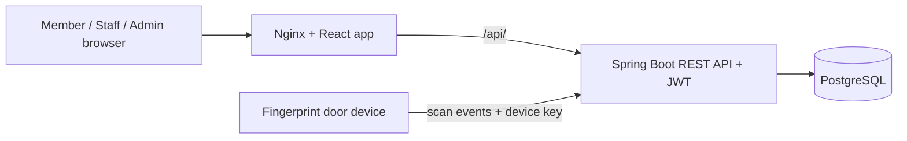

# Fitness Addicted Gym

A gym management system built with **Java 25, Spring Boot and React + TypeScript**. It covers the everyday
work of a gym: members, memberships, front-desk payments, attendance and a fingerprint-door integration,
with privacy features (consent records and an audit log) built in from the start.

> Status: **working and tested, not deployed.** The fingerprint door is simulated (no hardware yet).
> See [Known limitations](#known-limitations) and the [roadmap](#roadmap).

## Features

**Roles:** Member, Staff and Admin, enforced with stateless JWT authentication and method-level authorisation.

**Memberships and billing**
- Membership plans, with queued renewals (a second purchase starts when the first ends)
- Freeze and unfreeze, which shifts the end date and any queued membership
- Daily job that expires finished memberships and starts queued ones
- Manual (front-desk) payments with numbered receipts
- One-time, non-refundable joining fee, charged with a member's first sale as its own payment
- Refunds, limited by the server to a 7-day window (the staff screen hides the button after that)
- In-app and email notifications: expiry reminders, freeze ended, receipts and refunds

**Attendance and the fingerprint door**
- Door scans arrive at a key-authenticated device endpoint and are all stored in a door log
- **Attendance is marked once per member per day** (Indian time), however many times they go in and out
- Enforced by a unique database index and an atomic insert, so re-sent events cannot create duplicates
- Scans from unknown fingerprints or members without an active membership are logged and refused
- Staff screen to link a member to their device number, plus a live door log
- Front-desk check-in and check-out as a fallback

**Staff dashboard:** members, active members, visited today, expiring memberships and monthly revenue.

**Privacy**
- Purpose-specific consent records, stored as an append-only history
- Separate, optional consent for fingerprint door access. Staff cannot link a device number without it,
  and withdrawing it clears the link
- Fingerprints are stored on the door device only. The database holds just a device user number
- Audit log for sensitive actions such as login failures, health-note views and device linking

## Architecture

A modular monolith: one Spring Boot app and one PostgreSQL database, with Nginx serving the React app and
forwarding `/api/` to the backend.



How a door scan works:

1. The device unlocks the door by itself from its own stored list, so the door does not depend on the server.
2. It sends each scan (device serial, user number, time) to `POST /api/v1/device/events` with an `X-Device-Key` header.
3. The server stores every scan in `door_event`.
4. If the member has an active membership, it inserts one `attendance` row for that day with
   `ON CONFLICT DO NOTHING`. Later scans that day are recorded as re-entries.
5. The exit button is wired to the lock only and involves no software.

The door log is read through a separate staff-only endpoint, so the device key can never read data.

## Tech stack

| Layer | Technology |
|---|---|
| Backend | Java 25, Spring Boot 3.5, Spring Security (JWT), Spring Data JPA |
| Database | PostgreSQL 16 with the pgvector extension, Flyway migrations (V1 to V13) |
| Frontend | React, TypeScript, Vite, Tailwind CSS, TanStack Query |
| Email | Spring Mail (SMTP), off unless enabled |
| Testing | JUnit 5, MockMvc, Testcontainers (real PostgreSQL) |
| DevOps | Docker, Docker Compose, Nginx |

## Quick start (Docker, full stack)

Prerequisites: Docker Desktop.

```powershell
# 1. Create your own settings file from the template
Copy-Item .env.example .env.prod

# 2. Edit .env.prod and replace every CHANGE_ME value
#    Generate a random secret (run once per secret):
$b = New-Object byte[] 48
[Security.Cryptography.RandomNumberGenerator]::Create().GetBytes($b)
[Convert]::ToBase64String($b)

# 3. Build and start the database, backend and frontend
docker compose -f docker-compose.prod.yml --env-file .env.prod up -d --build
```

Open <http://localhost>. The first admin account is created from `BOOTSTRAP_ADMIN_EMAIL` and
`BOOTSTRAP_ADMIN_PASSWORD`, and only if no admin exists yet.

### Try the door without a device

Link a member to a device number on their staff page (the member must first switch on fingerprint door
access under **Profile**), then send a fake scan:

```powershell
$key = (Get-Content .env.prod | Where-Object { $_ -like 'DEVICE_API_KEY=*' }).Substring(15)
Invoke-RestMethod -Method Post -Uri http://localhost/api/v1/device/events `
  -Headers @{ 'X-Device-Key' = $key } -ContentType 'application/json' `
  -Body (@{ deviceSerial = 'TEST-1'; deviceUserId = 1; scannedAt = (Get-Date).ToUniversalTime().ToString('o') } | ConvertTo-Json)
```

The first scan of the day returns `ATTENDANCE_MARKED` and later ones `RE_ENTRY`. An unknown number returns
`UNKNOWN_USER`. Everything shows up under **Door log**.

## Local development

Prerequisites: JDK 25, Maven 3.9+, Node 22, Docker.

```bash
docker compose up -d db          # PostgreSQL + pgvector
cd backend
mvn spring-boot:run -Dspring-boot.run.profiles=dev
```

API docs (development profile): <http://localhost:8080/swagger-ui.html>

## Tests

The integration tests start a real PostgreSQL with Testcontainers, so Docker must be running.

```bash
cd backend
mvn clean test
```

48 integration tests cover plans, subscriptions (queue, freeze, cancel, expiry), attendance, payments,
the joining fee, refunds and notifications.

## Backups

`backup.ps1` dumps the database to the `backups/` folder (ignored by Git) and keeps the newest 14 files.
It can run daily as a Windows scheduled task. A restore into a scratch database has been tested.
Copy the folder somewhere off the machine from time to time, because a backup on the same disk
does not survive that disk failing.

## Environment variables

| Variable | Purpose |
|---|---|
| `DB_PASSWORD` | Database password (`DB_NAME` and `DB_USER` are optional) |
| `JWT_SECRET` | Signs access tokens. At least 32 bytes, required |
| `CORS_ALLOWED_ORIGINS` | Origins allowed to call the API, for example `http://localhost` |
| `BOOTSTRAP_ADMIN_EMAIL`, `BOOTSTRAP_ADMIN_PASSWORD` | Creates the first admin, only if none exists |
| `DEVICE_API_KEY` | Shared key for the door device. At least 32 characters. Scans are refused while it is blank |
| `EMAIL_ENABLED` | Turns email sending on (default `false`) |
| `MAIL_HOST`, `MAIL_PORT`, `MAIL_USERNAME`, `MAIL_PASSWORD`, `MAIL_FROM` | SMTP settings |
| `OLLAMA_BASE_URL` | Reserved for the planned AI assistant. Nothing uses it yet |

Never commit real values. `.env.prod` is ignored by Git, and `.env.example` contains placeholders only.

## Known limitations

- **The fingerprint device is simulated.** No hardware has been installed. The integration is tested end to end
  with fake scans. A real device still needs a model chosen and a sync step (adding and removing members on it).
- **No "who is inside now" figure.** The door exit button is wired to the lock only, so exits are never recorded.
  The dashboard shows "Visited today" instead.
- **No HTTPS yet.** Traffic is plain HTTP, so run it on a trusted local network only.
- **Spring Boot 3.5 is out of free open-source support** (it ended on 2026-06-30). The app runs on the latest 3.5 patch.
  Moving to a supported release is planned.
- **Payments are recorded manually** at the front desk. There is no online payment gateway.
- **The AI assistant is built and integrated.** It uses RAG to answer member questions based on the gym's policy documentation. It requires a local Ollama instance with Llama 3.2.

## Roadmap

- [x] Authentication, roles, member profiles and consent records
- [x] Plans, subscriptions (queue, freeze, cancel, daily expiry)
- [x] Manual payments, receipts, refunds, joining fee
- [x] In-app and email notifications
- [x] React app: staff dashboard, member management, door access and door log
- [x] Fingerprint door integration (simulated device), once-a-day attendance, biometric consent
- [x] Daily database backup with a tested restore
- [ ] Real device integration and member sync
- [ ] HTTPS and hosting
- [ ] Classes, bookings and trainer plans
- [x] AI assistant (RAG over the gym's own documents) with local models through Ollama
- [ ] CI pipeline

## Project structure

```
fitness-addicted-gym-rag/
├── backend/                  Spring Boot application (modules under com.fitnessaddicted.gym)
├── frontend/                 React + TypeScript app, served by Nginx in Docker
├── docs/                     Architecture and ER diagram
├── docker-compose.yml        Development database
├── docker-compose.prod.yml   Database, backend and frontend
├── backup.ps1                Database backup script
└── .env.example              Settings template
```

## License

To be decided (MIT is a common choice for portfolio projects).
