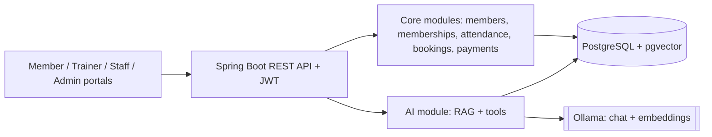

# Fitness Addicted Gym

An AI-powered gym management system built with **Java 25, Spring Boot and Spring AI**. It combines the
everyday operations of a gym (members, memberships, attendance, classes, payments) with a
**RAG-based assistant** that answers questions from the gym's own documents and live data, running
on **local open models through Ollama**.

> Status: **Phase 1 in progress** (auth, members, memberships, payments and notifications are working). See the [roadmap](#roadmap).

## Why this project

Gym owners answer the same questions all day (plans, timings, policies) and chase renewals by hand.
This system automates the routine work and gives members an assistant that is grounded in the gym's
real policies and schedule, instead of guessing.

## Features

- Role-based access: Member, Trainer, Staff, Admin
- Membership plans, subscriptions, freeze / renew / expiry reminders
- Manual (front-desk) payments with receipts and refunds
- In-app and email notifications: expiry reminders (7, 3 and 1 days before), freeze ended, payment receipts and refunds
- QR or front-desk check-in and live occupancy
- Class schedule, booking, capacity and waitlist (planned)
- Trainer workflows: assignments, workout and diet plans with AI-assisted drafts (planned)
- **AI assistant (RAG):** policy / plan / FAQ answers with cited sources, plus read-only live lookups
  (class availability, "when does my plan expire?") through tool calling (planned)
- Admin dashboard: revenue, active members, churn, peak hours (planned)
- Privacy by design: audit log, purpose-specific consent, health data never sent to the LLM

## Architecture

Modular monolith: one Spring Boot app, one PostgreSQL database (with pgvector), strict module boundaries.



Details: [docs/architecture.md](docs/architecture.md) | [docs/er-diagram.md](docs/er-diagram.md)

## Tech stack

| Layer | Technology |
|---|---|
| Backend | Java 25, Spring Boot 3.5, Spring Security (JWT), Spring Data JPA |
| AI | Spring AI 1.1, Ollama (`llama3.2`, `nomic-embed-text`), PgVectorStore |
| Database | PostgreSQL 16 + pgvector, Flyway migrations |
| Email | Spring Mail (SMTP, for example Brevo) |
| Frontend | React + TypeScript (Vite), planned |
| DevOps | Docker, Docker Compose, GitHub Actions |

## Quick start (local)

Prerequisites: JDK 25, Maven 3.9+, Docker.

```bash
# 1. Configure
cp .env.example .env

# 2. Start PostgreSQL + pgvector (and optionally Ollama in Docker)
docker compose up -d db
# or, to run Ollama in Docker too (pulls the models once):
docker compose --profile ollama up -d

# 3. If you run Ollama natively instead, pull the models yourself
ollama pull llama3.2
ollama pull nomic-embed-text

# 4. Run the backend
cd backend
mvn spring-boot:run -Dspring-boot.run.profiles=dev
```

If `spring-boot:run` is unavailable, build and run the jar instead:

```bash
mvn clean package -DskipTests
java -jar target/gym-backend-0.1.0-SNAPSHOT.jar
```

Run the tests (needs Docker): `mvn clean test`

Then open:

- Health: http://localhost:8080/actuator/health
- API docs: http://localhost:8080/swagger-ui.html

Flyway creates the schema on first start (`V1` core, `V2` AI tables, `V3` sample plans, `V4` refresh tokens,
`V5` freeze tracking, `V6` manual payments, `V7` to `V10` notifications and email). To sign in as admin,
set `BOOTSTRAP_ADMIN_EMAIL` and `BOOTSTRAP_ADMIN_PASSWORD` first; the admin is only created if none exists
yet (see [docs/api.md](docs/api.md)).

### Environment variables

| Variable | Purpose | Default |
|---|---|---|
| `DB_URL`, `DB_USER`, `DB_PASSWORD` | Database connection | local `gymdb` |
| `JWT_SECRET` | JWT signing key (change in real use) | placeholder |
| `BOOTSTRAP_ADMIN_EMAIL`, `BOOTSTRAP_ADMIN_PASSWORD` | Creates the first admin, only if none exists | empty |
| `EMAIL_ENABLED` | Turns email sending on | `false` |
| `MAIL_HOST`, `MAIL_PORT` | SMTP server (for example Brevo: `smtp-relay.brevo.com`, `587`) | Gmail, `587` |
| `MAIL_USERNAME`, `MAIL_PASSWORD`, `MAIL_FROM` | SMTP login and verified sender address | empty |

Set secrets as environment variables on the machine or server and never commit them to git.
Email is off unless `EMAIL_ENABLED=true`. Failed emails are retried up to 5 times.

## Roadmap

- [x] **Phase 0:** architecture docs, ER diagram, schema v1, project skeleton, Docker Compose
- [ ] **Phase 1:** auth + roles, members, plans, subscriptions, attendance, React shell
  - [x] Part 1: JWT auth, roles, member profiles, consent ([API](docs/api.md))
  - [x] Part 2: membership plans, subscriptions (queue, freeze, cancel, daily expiry)
  - [x] Part 3: attendance (front-desk check-in / check-out, occupancy; QR self check-in later)
  - [ ] Part 4: React shell
- [ ] **Phase 2:** classes and bookings, trainer plans
  - [x] Manual payments, receipts and refunds
  - [x] Notifications: in-app and email (expiry reminders, freeze ended, receipts, refunds)
  - [ ] Classes and bookings, trainer plans
- [ ] **Phase 3:** document ingestion, RAG chat, tool calling, guardrails, evaluation set
- [ ] **Phase 4:** CI/CD, observability, backups, hosting

## Project structure

```
fitness-addicted-gym-rag/
├── backend/            Spring Boot application (modules under com.fitnessaddicted.gym)
├── frontend/           React app (Phase 1)
├── docs/               Architecture and ER diagram
├── .github/workflows/  CI
├── docker-compose.yml  PostgreSQL + pgvector, optional Ollama
└── .env.example
```

## License

To be decided (MIT is a common choice for portfolio projects).