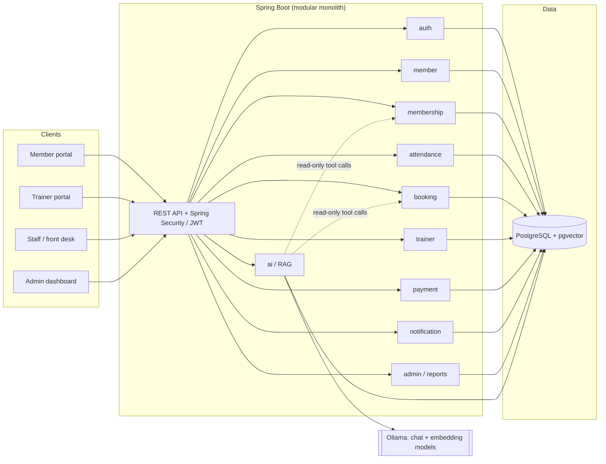
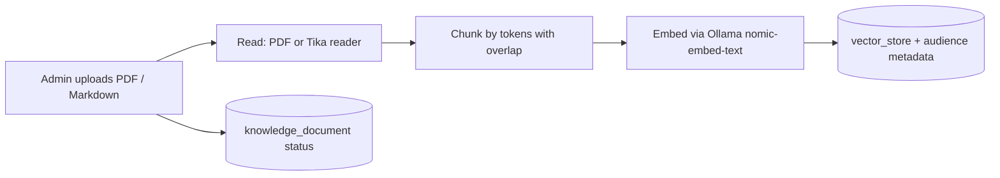
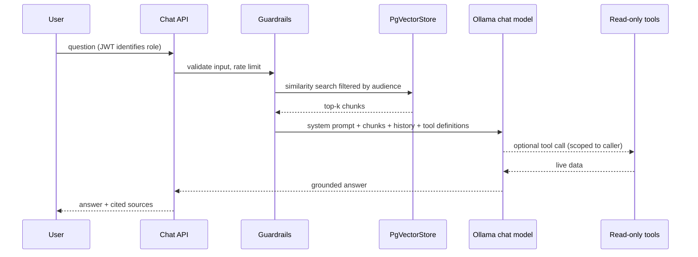

# Architecture

## 1. Style: modular monolith

One Spring Boot application, one PostgreSQL database, strict module boundaries inside the codebase.
For a single gym this is the right trade-off: simple to deploy, cheap to host, easy to reason about.
Modules talk through public service interfaces (never through each other's repositories), so any
module can be extracted into a service later if the business grows.



## 2. Modules

| Module | Responsibility | Phase |
|---|---|---|
| `auth` | Registration, login, JWT, roles (MEMBER, TRAINER, STAFF, ADMIN), password reset | 1 |
| `member` | Member profile, consent records, health data (restricted) | 1 |
| `membership` | Plans, subscriptions, freeze / renew / expire | 1 |
| `attendance` | Check-in / check-out by QR or front desk, occupancy | 1 |
| `booking` | Classes, sessions, capacity, waitlist, cancellations | 2 |
| `payment` | Invoices, gateway integration (Razorpay test mode), webhooks | 2 |
| `trainer` | Trainer profiles, assignments, workout and diet plans | 2 |
| `notification` | Email first, SMS / WhatsApp later, reminders (expiry, classes) | 2 |
| `ai` | Document ingestion, RAG chat, tool calling, guardrails | 3 |
| `admin` | KPIs: revenue, active members, churn, peak hours, audit viewer | 2-3 |
| `common` | Shared config, error handling, audit logging, base types | 1 |

Rule of thumb: a module may call another module's public service, never its repository or entities.

## 3. Package layout (per module)

```
com.fitnessaddicted.gym.<module>/
├── api/         REST controllers + request/response DTOs
├── domain/      JPA entities and domain rules
├── repository/  Spring Data repositories (package-private to the module)
└── service/     Public service interface + implementation
```

## 4. The AI module (RAG done properly)

The assistant answers two different kinds of questions, and they need different mechanisms:

| Question type | Example | Mechanism |
|---|---|---|
| Static knowledge | "What is your freeze policy?" | **RAG**: retrieve chunks from `vector_store`, answer with citations |
| Live data | "What classes are free tomorrow?" | **Tool calling**: a read-only service method queries the database |
| Personal data | "When does my plan expire?" | **Tool calling**, scoped to the authenticated user only |

Embeddings are the wrong place for data that changes hourly. Keeping these paths separate is what
makes the system trustworthy.

### Ingestion pipeline



### Question pipeline



### Guardrails (non-negotiable for a real gym)

1. Answer only from retrieved context or tool results; otherwise say "I don't know, please ask the front desk."
2. No medical advice. Workout and diet answers are general, with a disclaimer and a prompt to consult a professional.
3. Retrieval filters by `audience` so members never see staff-only content.
4. Tools are read-only, validated, and run with the caller's identity, not the model's.
5. Never put `health_notes`, phone numbers or payment details into prompts.
6. Every conversation is stored with its cited sources for review and debugging.

## 5. Security and privacy

- Spring Security with stateless JWT (short-lived access token, refresh token rotation).
- Method-level authorization (`@PreAuthorize`) on top of URL rules.
- Audit log for sensitive reads and every admin action.
- Passwords hashed with BCrypt (or Argon2).
- Purpose-specific consent records (terms, health data, marketing, AI processing), in line with the
  intent of India's DPDP Act. Have a lawyer review before real members' data goes in.
- Secrets only via environment variables, never committed.

## 6. Technology decisions

| Decision | Choice | Why |
|---|---|---|
| Language / runtime | Java 21 | LTS, virtual threads, records |
| Framework | Spring Boot 3.5.x | Stable line; Spring AI 1.1.x targets it |
| AI integration | Spring AI 1.1.x | ChatClient, advisors, tool calling, PgVectorStore |
| LLM runtime | Ollama (local models) | Free, private, no per-token cost; swappable via Spring AI |
| Chat model (default) | `llama3.2` (configurable) | Small, supports tool calling, runs on a laptop |
| Embedding model | `nomic-embed-text` (768 dims) | Good quality, small, pulls fast |
| Database | PostgreSQL 16 + pgvector | One store for relational and vector data |
| Migrations | Flyway | Versioned, reviewable schema changes |
| API docs | springdoc-openapi | Swagger UI for free |
| Frontend | React + TypeScript (Vite) | Dashboard-heavy UI; Phase 1 |
| Containers | Docker + Compose | Same stack locally and on the server |
| CI | GitHub Actions | Build and test on every push |

### Hosting note (important with Ollama)

Ollama needs RAM (and ideally a GPU). Typical free app hosts will not run a 3B+ model well.
Realistic options for the live demo:

1. Run the app on a small VPS with enough RAM and a small quantized model (slow but workable).
2. Host the app and database cheaply, and point `OLLAMA_BASE_URL` at a machine that can run models.
3. Use Ollama Cloud models through the same Ollama API (check current pricing first).

The code does not change between these options, only the base URL and model name.
We will decide in Phase 4; nothing in Phases 1-3 depends on it.

## 7. Roadmap

- **Phase 0 (this commit):** docs, schema v1, project skeleton, Docker Compose.
- **Phase 1:** auth + roles, members, plans, subscriptions, attendance, React shell.
- **Phase 2:** classes and bookings, payments (test mode), notifications, trainer plans.
- **Phase 3:** document ingestion, RAG chat, tool calling, guardrails, evaluation set.
- **Phase 4:** CI/CD, observability, backups, hosting, load and security checks.
