# Entity-Relationship Diagram

Source of truth for the schema is the Flyway migrations in
`backend/src/main/resources/db/migration`. This diagram is the human-readable view.

> GitHub renders Mermaid natively, so this diagram displays directly in the repo.

```mermaid
erDiagram
    APP_USER ||--o| MEMBER_PROFILE : "is a"
    APP_USER ||--o| TRAINER_PROFILE : "is a"
    APP_USER ||--o{ CONSENT_RECORD : gives
    APP_USER ||--o{ NOTIFICATION : receives
    APP_USER ||--o{ AUDIT_LOG : "acts in"
    APP_USER ||--o{ CHAT_CONVERSATION : starts

    MEMBER_PROFILE ||--o{ SUBSCRIPTION : holds
    MEMBERSHIP_PLAN ||--o{ SUBSCRIPTION : "sold as"
    SUBSCRIPTION ||--o{ PAYMENT : "paid by"
    MEMBER_PROFILE ||--o{ ATTENDANCE : "checks in"

    TRAINER_PROFILE ||--o{ TRAINER_ASSIGNMENT : coaches
    MEMBER_PROFILE ||--o{ TRAINER_ASSIGNMENT : "coached in"
    TRAINER_PROFILE ||--o{ GYM_CLASS : teaches
    GYM_CLASS ||--o{ CLASS_SESSION : "scheduled as"
    CLASS_SESSION ||--o{ BOOKING : "reserved via"
    MEMBER_PROFILE ||--o{ BOOKING : makes
    TRAINER_PROFILE ||--o{ TRAINING_PLAN : authors
    MEMBER_PROFILE ||--o{ TRAINING_PLAN : follows

    APP_USER ||--o{ KNOWLEDGE_DOCUMENT : uploads
    KNOWLEDGE_DOCUMENT ||--o{ VECTOR_STORE : "chunked into"
    CHAT_CONVERSATION ||--o{ CHAT_MESSAGE : contains

    APP_USER {
        bigint id PK
        varchar email UK
        varchar password_hash
        varchar role "MEMBER|TRAINER|STAFF|ADMIN"
        varchar status "ACTIVE|SUSPENDED"
        timestamptz created_at
    }
    MEMBER_PROFILE {
        bigint user_id PK,FK
        varchar full_name
        varchar phone
        date date_of_birth
        varchar gender
        varchar emergency_contact
        text health_notes "sensitive"
        date joined_on
    }
    TRAINER_PROFILE {
        bigint user_id PK,FK
        varchar full_name
        text bio
        varchar specialization
        varchar certifications
    }
    MEMBERSHIP_PLAN {
        bigint id PK
        varchar name UK
        text description
        int duration_days
        numeric price
        boolean active
    }
    SUBSCRIPTION {
        bigint id PK
        bigint member_id FK
        bigint plan_id FK
        date start_date
        date end_date
        varchar status "PENDING|ACTIVE|FROZEN|EXPIRED|CANCELLED"
        date frozen_until
    }
    PAYMENT {
        bigint id PK
        bigint subscription_id FK
        numeric amount
        varchar currency
        varchar status "CREATED|PAID|FAILED|REFUNDED"
        varchar gateway
        varchar gateway_ref UK
        timestamptz paid_at
    }
    ATTENDANCE {
        bigint id PK
        bigint member_id FK
        timestamptz check_in
        timestamptz check_out
        varchar source "QR|FRONT_DESK"
    }
    TRAINER_ASSIGNMENT {
        bigint id PK
        bigint trainer_id FK
        bigint member_id FK
        date assigned_on
        boolean active
    }
    GYM_CLASS {
        bigint id PK
        varchar name
        text description
        bigint trainer_id FK
        boolean active
    }
    CLASS_SESSION {
        bigint id PK
        bigint class_id FK
        timestamptz starts_at
        timestamptz ends_at
        int capacity
        varchar room
        varchar status "SCHEDULED|CANCELLED|DONE"
    }
    BOOKING {
        bigint id PK
        bigint session_id FK
        bigint member_id FK
        varchar status "CONFIRMED|WAITLISTED|CANCELLED|ATTENDED|NO_SHOW"
        timestamptz booked_at
    }
    TRAINING_PLAN {
        bigint id PK
        bigint member_id FK
        bigint trainer_id FK
        varchar type "WORKOUT|DIET"
        text content
        boolean ai_assisted
        timestamptz created_at
    }
    NOTIFICATION {
        bigint id PK
        bigint user_id FK
        varchar channel "EMAIL|SMS|WHATSAPP|IN_APP"
        varchar type
        varchar status "PENDING|SENT|FAILED"
        timestamptz sent_at
    }
    CONSENT_RECORD {
        bigint id PK
        bigint user_id FK
        varchar purpose "TERMS|HEALTH_DATA|MARKETING|AI_PROCESSING"
        boolean granted
        timestamptz recorded_at
    }
    AUDIT_LOG {
        bigint id PK
        bigint actor_id FK
        varchar action
        varchar entity_type
        varchar entity_id
        jsonb details
        timestamptz created_at
    }
    KNOWLEDGE_DOCUMENT {
        bigint id PK
        varchar title
        varchar source_type "PDF|MARKDOWN|TEXT"
        varchar file_name
        varchar checksum
        varchar audience "PUBLIC|MEMBER|STAFF"
        varchar status "UPLOADED|INDEXING|INDEXED|FAILED"
        int version
        bigint uploaded_by FK
        timestamptz indexed_at
    }
    VECTOR_STORE {
        uuid id PK
        text content
        jsonb metadata "document_id, audience, page"
        vector embedding "768 dims (nomic-embed-text)"
    }
    CHAT_CONVERSATION {
        bigint id PK
        bigint user_id FK
        varchar title
        timestamptz created_at
    }
    CHAT_MESSAGE {
        bigint id PK
        bigint conversation_id FK
        varchar role "USER|ASSISTANT"
        text content
        jsonb sources "chunks cited in the answer"
        timestamptz created_at
    }
```

## Design notes

- **`app_user` vs profiles:** one login identity, with role-specific profile tables. A trainer who is
  also a member is possible later without duplicating credentials.
- **`health_notes` is sensitive personal data.** It is never sent to the LLM and is only readable by the
  member, their assigned trainer and admins (enforced in the service layer and logged in `audit_log`).
- **`knowledge_document.audience`** is copied into each chunk's metadata so retrieval can filter by the
  caller's role. A member must never retrieve a chunk meant for staff only.
- **`vector_store`** uses Spring AI's default table layout so the `PgVectorStore` works unchanged.
  Dimension 768 matches `nomic-embed-text`. Changing the embedding model means re-indexing.
- **Money** is `numeric(10,2)` with an explicit currency (default INR). Never use floating point.
- **`consent_record`** supports DPDP-style purpose-specific consent, including consent for AI processing.
